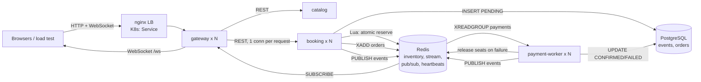

# TicketRush: Distributed Flash-Sale Ticketing Platform

**Distributed Systems Mini Project.** A small microservice system that sells a limited number of
event tickets to thousands of simultaneous buyers **without ever overselling**, scales horizontally
under load, and keeps working when a worker crashes mid-payment.

> Think of a concert going on sale at 10:00 sharp. 100 seats and 2,000 people clicking "Book" in
> the same second. Every request can land on a different server, so how do you make sure exactly
> 100 tickets are sold, not 101, while staying fast and surviving crashes?

How it differs from our FA project (traffic incident system): the FA had **fixed regional nodes**
talking over gRPC/P2P with per-node SQLite. TicketRush is about **elastic scaling of stateless
replicas, a shared consistency problem (contended inventory), asynchronous queue-based
processing, and orchestration with Kubernetes autoscaling**.

---

## 1. Architecture



| Service | Role | Scales? | Talks to |
|---|---|---|---|
| `gateway` | Single entry point: serves dashboard, routes REST, relays live events over WebSocket, reports cluster state | Yes (stateless) | catalog, booking (REST); Redis (pub/sub) |
| `catalog` | Owns events; seeds and **reconciles** Redis inventory from PostgreSQL; consistency audit | Yes (idempotent start-up) | PostgreSQL, Redis |
| `booking` | Atomic seat reservation, writes PENDING order, enqueues payment; reaper expires unpaid holds | **Yes**, HPA 2–10 | Redis (Lua, Streams), PostgreSQL |
| `payment-worker` | Competing consumers on a Redis Stream; simulated payment + fraud scoring; confirms or releases seats | **Yes**, HPA 1–8 | Redis Streams, PostgreSQL |
| `redis` | Inventory counters, message stream, pub/sub, membership heartbeats | – | – |
| `postgres` | Durable system of record | – | – |
| `lb` (Compose only) | nginx load balancer in front of gateway replicas (a K8s Service does this in the cluster) | – | gateway |

### Booking flow (`POST /api/bookings`)

1. **gateway → booking** (REST). A fresh upstream connection per request, so every request is load-balanced across replicas.
2. **booking → Redis**: a Lua script checks stock and the per-user limit (4), then decrements. It's atomic, so no two replicas can sell the same seat.
3. **booking → PostgreSQL**: `INSERT order (PENDING)`. If this fails, seats are released immediately (compensation).
4. **booking → Redis Stream** `orders`: `XADD`. Reply **202 Accepted** with the order id (async processing).
5. **payment-worker** (consumer group `payments`): checks the order is still PENDING, charges (simulated latency, 10% declines, CPU-bound fraud score), then `UPDATE ... WHERE status='PENDING'`, and only then `XACK`.
6. On failure or expiry, seats go back to inventory via an **idempotent** release script and are resold to later buyers.
7. Every step is `PUBLISH`ed. The gateway pushes it to dashboards over WebSocket.

## 2. Distributed-systems concepts demonstrated

| Concept | Where | How to see it |
|---|---|---|
| **Horizontal scaling / stateless services** | `booking`, `gateway`, `payment-worker` | `docker compose up --scale booking=5`, `kubectl scale`, HPA |
| **Load balancing** | nginx (`nginx.conf`), Docker DNS round-robin, K8s Service, `force_close` in `app/gateway/main.py` | Dashboard per-replica bars; load test "Served by" histogram |
| **Autoscaling** | `k8s/21-booking.yaml`, `k8s/22-payment-worker.yaml` (HPA), optional KEDA on queue lag | `kubectl get hpa -w` during load test |
| **Inter-service communication: sync** | REST gateway → catalog/booking | `X-Handled-By` / `X-Gateway` response headers |
| **Inter-service communication: async** | Redis Streams consumer group | Dashboard "waiting in stream / in flight" |
| **Publish/subscribe + streaming to clients** | Redis pub/sub → WebSocket | Live activity feed |
| **Consistency under concurrency** | `app/common/inventory.py` (Lua) | Audit: `remaining + sold + pending == capacity`, never oversold |
| **At-least-once delivery, exactly-once effect** | `XACK` after processing, `WHERE status='PENDING'`, `SET NX` release marker | Kill a worker: no double charge, no seat leak |
| **Fault tolerance / recovery** | `XAUTOCLAIM` in `app/payment/worker.py` | `docker kill` a worker mid-sale; "taken over" entries in feed |
| **Leases / timeouts** | Reservation hold + reaper in `app/booking/main.py` | Orders `EXPIRED` and seats resold |
| **Leaderless coordination** | Every booking replica runs the reaper; `UPDATE … RETURNING` gives each row to exactly one | No leader election needed |
| **Membership / failure detection** | Heartbeat keys with TTL (`instance:<role>:<id>`) | Dead replicas grey out on dashboard |
| **Saga / compensation** | DB insert fails → release; payment fails → release | `released` count in audit |
| **Service discovery** | Env-configured DNS names (`booking`, `redis`, …) | Same image in Compose and K8s |
| **State reconciliation** | `catalog` rebuilds inventory from DB with `SET NX` | Flush Redis, restart catalog |
| **Containerisation & orchestration** | `Dockerfile`, `docker-compose.yml`, `k8s/` | Probes, resource limits, StatefulSet, NodePort |

The full design rationale, failure analysis, measured results and viva questions are in **[`docs/REPORT.md`](docs/REPORT.md)**.

## 3. Run it (Docker Compose, the easy way)

Requirements: Docker Desktop (or Docker Engine + Compose v2).

```bash
docker compose up --build -d
# open http://localhost:8080
```

That starts nginx → 2 gateways → 3 booking replicas + 2 payment workers + catalog + Redis + PostgreSQL.
Three demo events are seeded automatically (500, 300 and 100 seats).

Scale while it's running:

```bash
docker compose up -d --scale booking=5 --scale payment-worker=4 --scale gateway=3
```

Stop: `docker compose down` (add `-v` to also wipe the database).

## 4. Run it on Kubernetes

Works on any local cluster: **kind**, **minikube** or **Docker Desktop's built-in Kubernetes**.

```bash
# 1. Build the image
docker build -t ticketrush:latest .

# 2a. kind (3-node cluster, tested)
kind create cluster --name ticketrush --config k8s/kind-config.yaml
kind load docker-image ticketrush:latest --name ticketrush
# 2b. or minikube
minikube start --cpus 4 && minikube image load ticketrush:latest && minikube addons enable metrics-server

# 3. Deploy everything
kubectl apply -k k8s
kubectl -n ticketrush get pods -w

# 4. Dashboard
#    kind: http://localhost:30080   minikube: minikube service gateway -n ticketrush
```

For autoscaling, the cluster needs **metrics-server**:

```bash
kubectl apply -f https://github.com/kubernetes-sigs/metrics-server/releases/download/v0.7.2/components.yaml
# kind only: kubelets use self-signed certs
kubectl -n kube-system patch deployment metrics-server --type=json \
  -p '[{"op":"add","path":"/spec/template/spec/containers/0/args/-","value":"--kubelet-insecure-tls"}]'
```

> **If pods sit in `ImagePullBackOff` on kind** (common on corporate networks where the kind node
> cannot reach Docker Hub), pull on the host and load the images in:
> ```bash
> for img in redis:7.4-alpine postgres:16-alpine; do
>   docker pull $img && echo "FROM $img" | docker build -t $img - && kind load docker-image $img --name ticketrush
> done
> ```
> (The `FROM` rebuild turns the multi-arch image into a single-platform one, which `kind load` needs on Docker Desktop.)

Clean up: `kubectl delete -k k8s` or `kind delete cluster --name ticketrush`.

## 5. Load test & correctness check

```bash
pip install aiohttp
python tools/loadtest.py --url http://localhost:8080 --event 3 --requests 2000 --concurrency 150
#   (use --url http://localhost:30080 for the kind cluster)
```

It resets the event, fires the requests, prints throughput, latency and which replica served what,
waits for the payment queue to drain, then audits consistency. Exit code 0 = PASS. Sample output (real run):

```
Throughput : 344 req/s (5.81s)
Outcomes   : 202=108, 409=1892
Served by gateway replica:
  gateway-74d8d4b487-vpv88           1008  ####################
  gateway-74d8d4b487-xlj49            992  ####################
Served by booking replica:
  booking-5cd7bdb8c4-2txpg            661  #############
  booking-5cd7bdb8c4-6zpj2            699  ##############
  booking-5cd7bdb8c4-cw2kw            640  #############
Audit: {'capacity': 100, 'redis_remaining': 0, 'confirmed': 100, 'pending': 0, 'released': 8, 'oversold': False, 'consistent': True}
PASS: 100 confirmed of capacity 100, 8 seats released after failed/expired payments and resold, oversold=False
```

(108 got a 202 for 100 seats because 8 payments failed, and those seats were sold again.)

## 6. Live demo script (about 10 minutes)

| # | Do this | Point out |
|---|---|---|
| 1 | `docker compose up -d`, open the dashboard | 3 booking replicas + 2 workers alive, each with its container id |
| 2 | Click **Book 1** a few times | Feed shows `RESERVED`, then `CONFIRMED`/`FAILED` from different instances |
| 3 | Flash sale on *Midnight Stand-up* (100 seats, 400 requests) | Even spread across replicas; exactly 100 sold; click **Audit** → *Consistent* |
| 4 | `docker compose up -d --scale booking=5 --scale payment-worker=4` | New replicas appear on the dashboard and start taking traffic immediately |
| 5 | Run a rush, and while it runs: `docker kill ticketrush-payment-worker-1` | Worker greys out; ~30s later its unacked orders show "taken over"; audit still consistent |
| 6 | `docker compose stop booking` then start again | Gateway returns 503 (fails fast), then recovers; no data lost |
| 7 | (K8s) `kubectl -n ticketrush get hpa -w` during a long load test | Booking pods 3 → 10, workers 2 → 8 |

## 7. Project layout

```
ticketrush/
├── app/
│   ├── common/        config, PostgreSQL schema, Redis helpers, atomic inventory (Lua)
│   ├── gateway/       API gateway + dashboard (static/)
│   ├── catalog/       events, inventory seeding/reconciliation, audit
│   ├── booking/       reservation API + hold-expiry reaper
│   └── payment/       consumer-group payment worker
├── k8s/               Namespace, ConfigMap/Secret, Redis, PostgreSQL StatefulSet, Deployments,
│   │                  Services, HPAs, kustomization, kind config
│   └── optional/      KEDA ScaledObject (scale workers on queue backlog)
├── tools/loadtest.py  flash-sale load generator + consistency audit
├── docs/REPORT.md     design, failure analysis, experiments, viva prep
├── Dockerfile         one image, command selects the service
├── docker-compose.yml
└── nginx.conf         load balancer for gateway replicas (Compose)
```

## 8. Tech stack

Python 3.12 · FastAPI · asyncio · Redis 7 (Lua, Streams, pub/sub) · PostgreSQL 16 (asyncpg) · aiohttp ·
nginx · Docker / Compose · Kubernetes (Deployments, StatefulSet, Services, HPA, probes) · optional KEDA.
